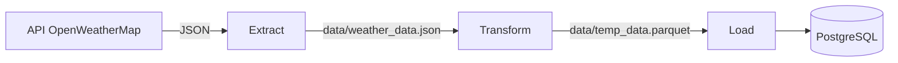

# Pipeline ETL de dados meteorológicos

Pipeline de dados que, de hora em hora, vai buscar o clima actual à API do [OpenWeatherMap](https://openweathermap.org/api), organiza a resposta numa tabela e guarda-a numa base de dados PostgreSQL. A orquestração é feita com Apache Airflow, a correr em Docker.


## Como funciona



O Airflow corre a DAG `youtube_tutorial` a cada hora (`0 */1 * * *`). São três tarefas em sequência:

1. **Extract** ([src/extract_data.py](src/extract_data.py)): faz o pedido à API e guarda a resposta em bruto em `data/weather_data.json`.
2. **Transform** ([src/transform_data.py](src/transform_data.py)): com pandas:
   - "achata" o JSON aninhado (`main.temp`, `wind.speed`, …) em colunas;
   - extrai o primeiro item da lista `weather` (condição e descrição);
   - remove colunas sem utilidade e renomeia as restantes para nomes claros;
   - converte os timestamps Unix (`datetime`, `sunrise`, `sunset`) para a hora local;
   - garante sempre o mesmo esquema de 30 colunas. Os campos opcionais que a API nem sempre envia, como `rain_1h` e `snow_1h`, ficam `NULL`.
3. **Load** ([src/load_data.py](src/load_data.py)): acrescenta a linha à tabela `sp_weather` no PostgreSQL com SQLAlchemy, de modo que o histórico vai crescendo a cada execução.

Como cada tarefa do Airflow corre isolada, os dados passam do Transform para o Load através de um ficheiro Parquet intermédio. Se uma tarefa falhar, é repetida até 2 vezes, com 5 minutos de intervalo.

## Tecnologias

- **Python 3.14** com `uv` para gerir dependências
- **pandas** para a transformação
- **requests** para chamar a API
- **SQLAlchemy + psycopg2** para escrever na base de dados
- **PostgreSQL**
- **Apache Airflow 3** em **Docker Compose**

## Estrutura

```
├── dags/
│   └── weather_dags.py      # DAG do Airflow (extract >> transform >> save)
├── src/
│   ├── extract_data.py      # Extracção da API
│   ├── transform_data.py    # Limpeza e padronização
│   └── load_data.py         # Carga no PostgreSQL
├── notebooks/
│   └── analitcs.ipynb       # Exploração inicial dos dados
├── main.py                  # Corre o pipeline completo sem Airflow
├── docker-compose.yaml      # Airflow (LocalExecutor) + Postgres de metadados
├── .env.example             # Variáveis de ambiente necessárias
└── pyproject.toml
```

## Como executar

### 1. Pré-requisitos

- Python 3.14 e [uv](https://docs.astral.sh/uv/)
- Docker e Docker Compose
- PostgreSQL instalado na máquina, onde ficam os dados do pipeline
- Uma chave gratuita da API do OpenWeatherMap

### 2. Variáveis de ambiente

Copia o [.env.example](.env.example) e preenche os valores:

```bash
# na raiz: só o UID para o Docker
echo "AIRFLOW_UID=$(id -u)" > .env

# credenciais do pipeline
mkdir -p config
cp .env.example config/.env   # e edita com a tua chave e dados do Postgres
```

### 3. Correr localmente, sem Airflow

```bash
uv sync
uv run main.py
```

### 4. Correr com o Airflow

```bash
docker compose up -d
```

Abre `http://localhost:8080` (utilizador e palavra-passe `airflow`), activa a DAG `youtube_tutorial` e o pipeline passa a correr de hora em hora.

> O `docker-compose.yaml` está ajustado para máquinas com pouca memória (cerca de 8 GB): usa o `LocalExecutor` em vez do Celery e não carrega as DAGs de exemplo. Dentro dos containers, o Postgres da máquina é acedido em `host.docker.internal`, por isso tem de aceitar ligações vindas da rede do Docker (`listen_addresses` e `pg_hba.conf`).

## Exemplo de registo

| datetime | city_name | temperature | humidity | rain_1h | weather_main |
|---|---|---|---|---|---|
| 2026-11-07 16:14 | São Paulo | 21.57 | 91 | 8.65 | Thunderstorm |
